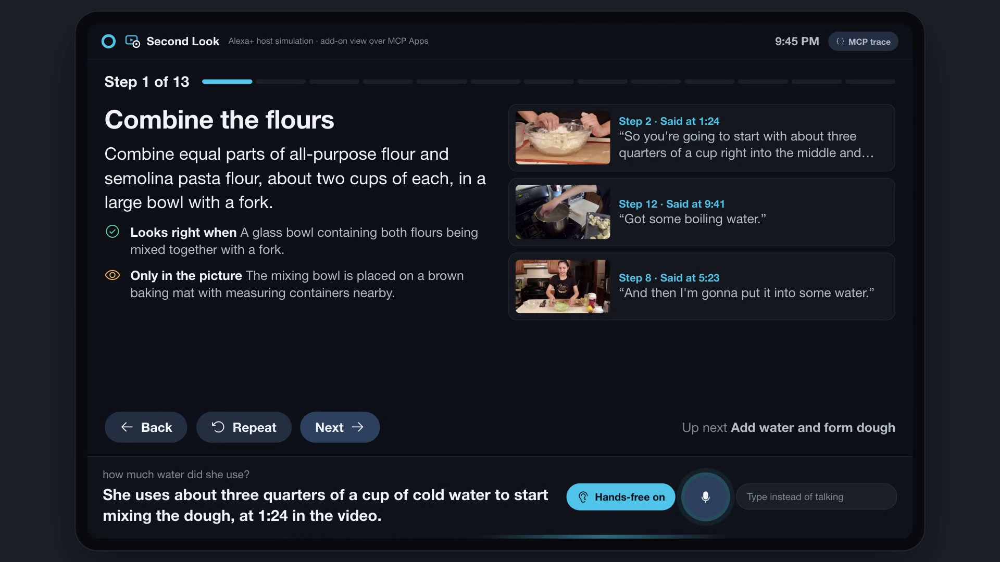

# Second Look

**Alexa+ follows a cooking video with you, hands-free, because it actually watched the video.**

Cooking from a video is awkward when your hands are covered in flour: the video keeps going, you can't scrub back, a quantity is said once and gone, and you never know if yours looks right. Recipe tools can turn the *captions* into a text recipe. Second Look gives Alexa+ the video itself:

- **"Alexa, how much water did she use?"** It answers from what was said *and when*: "about three quarters of a cup of cold water to start; she says it at 1:24", with the evidence on screen and the moment ready to replay.
- **"Alexa, how much sugar?"** "The video never mentions sugar." An amount question about something the video never mentions gets no evidence back, so Alexa says so instead of reading out the nearest other number.
- **"Show me how she makes the shape with her thumb."** It finds the moment she describes the move, shows the frame a beat later and replays the clip, and describes details the narrator never says (hand position, thickness, texture).
- **"Next." "Go back." "Repeat that."** One step at a time, read aloud, never skipping ahead on its own.
- **"Set a timer for the rest."** The 30-minute rest from the video becomes a real timer.
- **"I'm back, where was I?"** Close the app, restart everything, come back later: your step and your timers are still there.
- **Hands-free mode.** Like an Echo Show, the screen keeps listening and acts only on sentences that start with "Alexa". It closes the microphone while Alexa talks, while the agent works and while a clip plays (the view reports when playback starts and stops), so it doesn't take its own voice or the cook in the video for a request.

Track: **Alexa+** (self-hosted MCP server, spec 2025-11-25, Streamable HTTP) · Mini challenges: **AWS Builder** (Strands Agents SDK), **Open Source**.

> Demo video: https://youtu.be/tgE5cRr50LM



---

## How it works

```
 you ── "Alexa, ..." ──┐
                       ▼
 ┌──────────────── simulated Alexa+ host (web/, an Echo Show 15 class screen) ────────────────┐
 │ voice (Web Speech API, hands-free wake word) ─▶ /api/turn ─▶ Strands agent ─┐              │
 │ add-on view: ui://second-look/cook.html in a sandboxed iframe               │ MCPClient    │
 │   ▲ MCP Apps over postMessage: ui/initialize, ui/notifications/tool-result, │ (Streamable  │
 │   │ tools/call proxied by the host                                         │  HTTP)        │
 │   └──── host: MCP client + MCP Apps host ───────────────────────────────────┤              │
 └──────────────────────────────┬──────────────────────────────────────────────┼──────────────┘
                                │ MCP 2025-11-25: initialize · tools/list · resources/read · tools/call
                                ▼                                              ▼
 ┌──────────────────────────── crv-guide MCP server (server/) ─────────────────────────────────┐
 │ import_video ─▶ crv watches the video (scene-change keyframes + timestamped transcript)      │
 │              ─▶ a multimodal model writes the guide; checks.py checks its numbers         │
 │ start_session · get_session · move_step · ask_source · show_moment · set_timer …           │
 │   (session tools carry _meta.ui.resourceUri → the ui:// view, text/html;profile=mcp-app)   │
 │ SQLite: guides, sessions, step progress, timer deadlines (survives restarts)               │
 └────────────────────────────────────────────────────────────────────────────────────────────┘
```

**The add-on UI is built the way Alexa+ renders add-ons.** Amazon's Alexa+ add-on guide describes an add-on's screen as a self-contained HTML bundle that Alexa shows in a sandboxed iframe and talks to over the MCP Apps postMessage bridge ([Layout and Rendering](https://developer.amazon.com/en-US/docs/alexaplus/add-ons/mcp-addon-layout-and-rendering.html)). So the server registers one `ui://second-look/cook.html` resource (MIME `text/html;profile=mcp-app`, with its CSP in `_meta.ui`) through the MCP Python SDK's Apps extension, and the session tools point at it with `_meta.ui.resourceUri`. The view is authored on Amazon's 768 px base canvas (Block viewport, scaled 1.667x on an Echo Show 8/15) with the guide's type, spacing, radius and dark card colour tokens ([Visual Foundations](https://developer.amazon.com/en-US/docs/alexaplus/add-ons/mcp-addon-visual-foundations.html)). Text-only MCP clients simply ignore it.

**The simulated device is an MCP Apps host.** It reads the resource, mounts it in a `sandbox="allow-scripts"` iframe, answers `ui/initialize` with a host context (theme, container size, device class), forwards every tool result from the agent's turn as `ui/notifications/tool-result`, and proxies the view's own `tools/call` (its Back / Next buttons, evidence cards) to the server. When Alexa answers with a moment, the host shows it after she has finished speaking; the view shows the frame, plays the clip and returns to the step by itself.

Plain navigation ("next", "go back", "repeat", "I'm back, where was I?") is routed straight to `move_step` / `get_session`, the way a voice platform maps simple intents, so it answers instantly and can't be misread by a model. Everything open-ended ("how much water?", "skip to the shaping", "show me the thumb move") goes to the Strands agent, which always gets the screen's current session and step outline with the request. Session tools also return a short voice-ready line (`speak`, like a skill's output speech), so Alexa says one or two sentences while the view shows the full card.

Two different MCP clients talk to the same server and share its state: the **Strands agent** (conversation) and the **host** (screen and add-on view). The **MCP trace** button shows both kinds of traffic live, in time order: MCP over Streamable HTTP (`initialize` with protocol `2025-11-25`, `resources/read` of the view, `tools/call` with arguments) and MCP Apps over postMessage (`ui/initialize`, `ui/notifications/tool-result`, the view's `tools/call`).

Alexa+ developer tools (MCP Toolkit, Web Simulator) are select-partners only, so, as the hackathon FAQ allows, the device is simulated. The server is a standard MCP server any MCP client can use, and its view follows the MCP Apps spec (tested in our simulated host only).

### MCP tools (server/src/crv_guide_mcp/server.py)

| Tool | What it does |
|---|---|
| `import_video(source)` | Watch a video (URL, local file, or `sample:pasta`) and build a guide. Returns a job id at once. |
| `get_import(job_id)` | Processing stage, or the finished guide outline (steps, ingredients, durations). |
| `list_guides()` | Guides already built. |
| `start_session(guide_id)` | Start cooking at step 1. Returns the step card + the step's video frame (image). |
| `get_session(session_id?)` | "Where was I?" Resumes the latest unfinished session, with live timer time-left. |
| `move_step(session_id, next/back/repeat/goto)` | Moves only when asked; `expected_revision` guards against double moves from two screens. |
| `ask_source(question)` | BM25 search over what was *said* (timestamped transcript windows) and what each step *shows*; each passage is pinned to the one transcript line that answers the question (`said_at`, e.g. 1:24, with a replay clip), plus matching frames as images. The assistant answers only from these. |
| `show_moment(query? \| at_seconds? \| step_number?)` | The exact frame (grabbed from the source video at that second) + a replayable clip range. `query` finds the moment from a description ("pressing the thumb into the dough"). |
| `set_timer(seconds, label, request_id?)` / `cancel_timer` | Timers stored as absolute deadlines; idempotent with `request_id`. |

Every step in a guide keeps its evidence: the frame number it was written from, its time range, the transcript lines behind each quantity, and a `visual_note` for something visible in the frames that the narration never says. The guide is checked against the real video before it is stored: frame numbers must exist and fall inside the step, times are clamped, line numbers must exist, and every number in an instruction (amounts, durations, temperatures) must appear in the narration the step cites or the lines spoken during it, with the same unit and, for an amount of something, next to the same ingredient word: "two cups of sugar" does not pass on "two teaspoons of salt" or "two cups of flour" (`checks.py`). Numbers that aren't said are flagged on the card ("Not said in the video"), and a timer is only offered for a duration that is said. It is a lexical check of numbers, units and nearby words, not a proof that an instruction is right. On the sample, one number in the steps isn't in the narration: "four pieces", which she describes as "cut it in half and then half again".

---

## Run it

Requirements: Python 3.11–3.13, `ffmpeg` on PATH, and one model key (OpenAI or Gemini). Tested on macOS (Apple Silicon).

```sh
git clone https://github.com/HUANGCHIHHUNGLeo/second-look && cd second-look
python3 -m venv .venv && .venv/bin/pip install -e .        # or: uv venv && uv pip install -e .
server/scripts/fetch_sample.sh                             # sample video for clip replay (CC BY, ~150 MB)
cp .env.example .env                                       # add OPENAI_API_KEY (or GEMINI_API_KEY + SECOND_LOOK_PROVIDER=gemini)
./run.sh                                                   # MCP server :8765 + screen :8770
```

Open http://127.0.0.1:8770 in Chrome, click **Load the sample video**, then tap the mic (or press Space) and talk, or type. The sample's guide ships pre-built in `server/fixtures/pasta/`, so it loads instantly; paste any other video URL to watch a new one (the guide step uses Gemini when `GEMINI_API_KEY` is set, otherwise OpenAI vision; in our tests on deadline night a 2.5-minute video took 5 to 12 minutes end to end).

Tests (install the test extra first: `.venv/bin/pip install -e '.[test]' && .venv/bin/playwright install chromium`): `.venv/bin/python -m pytest server/tests/test_core.py` (guide validation and number checks against the video, evidence search, ingredients the video never mentions, sessions, revision checks, idempotent timers) and `.venv/bin/python web/tests/handsfree_check.py` (hands-free mode in a real browser with a scripted recognizer).

Use the server from any MCP client: `.venv/bin/crv-guide-mcp --port 8765`, then connect to `http://127.0.0.1:8765/mcp` (Streamable HTTP). Smoke test with a real MCP client: `.venv/bin/python server/tests/smoke_client.py`.

---

## What was built during the hackathon

**Before** (existing open-source project by the same author): [claude-real-video (crv)](https://github.com/HUANGCHIHHUNGLeo/claude-real-video) could extract keyframes and a transcript from a video, with a local stdio MCP server for chat clients.

**Built for this hackathon (all of this repo):** the crv-guide Streamable HTTP MCP server (spec 2025-11-25) with persistent cooking sessions, step navigation, timers and evidence search; the frames-plus-transcript guide compiler with validation against the source video; exact-moment frame extraction and clip replay; the simulated Alexa+ screen with voice, cards and a live MCP trace; the Strands agent. crv is used unchanged as a library (pinned 0.10.7).

## AWS Builder mini challenge

The conversation runs on the **Strands Agents SDK** (AWS's open-source agent framework), in `second_look/agent.py`:

- `strands.tools.mcp.MCPClient(url=...)` connects to the crv-guide server over Streamable HTTP and loads its tools at startup (`list_tools_sync`).
- `strands.Agent(model=..., tools=..., hooks=[UiEvents()], conversation_manager=SlidingWindowConversationManager(16))` runs the tool loop. An `AfterToolCallEvent` hook forwards every tool result (step cards, evidence, frames, timers) to the screen.
- Model providers through Strands: `strands.models.openai.OpenAIModel` (default `gpt-4.1-mini`) or `strands.models.gemini.GeminiModel`. Inference runs on the provider's API; the agent loop runs locally. No AWS-hosted services are used.

## Security and privacy

- No keys in the repo; everything comes from `.env` (git-ignored). The screen never sees a key: the agent runs server-side.
- The MCP endpoint has DNS-rebinding protection (allowed Host/Origin lists) and a CORS allow-list limited to the screen's origin.
- Data stays local (SQLite + files under `~/.crv-guide`) except what is sent to the chosen model provider (frames and transcript for the guide; conversation and tool results for the agent).

## Honest limits

- Not tested on a real Alexa+ device or console: those tools are select-partners only. The simulated host speaks MCP and MCP Apps as described above; the add-on view has only been tested in that host. If a browser blocks autoplay, the clip shows its play button instead.
- Timers ring while the screen is open; after a restart they show "done" or the correct time left (deadlines are stored), but there are no background notifications.
- Voice uses the browser's Web Speech API (Chrome). Typing works everywhere. Hands-free mode was tested in Chromium with a scripted speech recognizer (`web/tests/handsfree_check.py`), not yet in a noisy kitchen; real recognition will sometimes mishear.
- Answers are only as good as what the video shows and says; when the search finds nothing the assistant says the video doesn't cover it. Answer wording comes from a model; the numbers it may use come from the quoted transcript line.
- Tested on two narrated cooking videos so far (the sample and a goat-chops recipe). The guide writer is written for cooking; a 2.5-minute video took about 5 minutes to import on a busy evening.

## Credits

- Sample video: "Cooking with Laura: Homemade Pasta" by Northampton Community Television, [CC BY 3.0](https://creativecommons.org/licenses/by/3.0/), via [Wikimedia Commons](https://commons.wikimedia.org/wiki/File:Cooking_with_Laura_Homemade_Pasta.webm). The bundled keyframes and transcript in `server/fixtures/pasta/` are derived from it under the same license.
- Built with [crv / claude-real-video](https://github.com/HUANGCHIHHUNGLeo/claude-real-video), the [MCP Python SDK](https://github.com/modelcontextprotocol/python-sdk), [Strands Agents](https://strandsagents.com), Gemini and OpenAI models.

License: MIT (code). Sample media: CC BY 3.0 as above.
